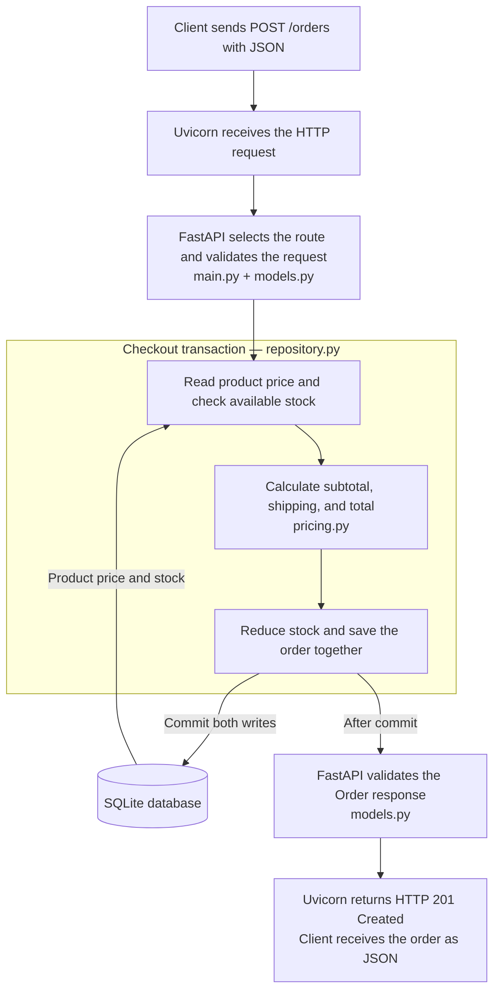

# Tiny Store API

Tiny Store is a Python backend for browsing products, placing orders, and looking
up saved orders. It calculates prices and shipping, checks available inventory,
and saves purchases in a SQLite database. The repository includes unit,
integration, and end-to-end tests for those behaviors.

The application exposes an **API**: URLs that another program can call to read
or change data. It returns **JSON**, a text format containing named values such
as `{"product_id": "mug", "quantity": 2}`. There is no storefront UI; you can use
the included Python client, curl, or the interactive API documentation.

## What each technology does

| Technology | Its job in this application |
| --- | --- |
| **FastAPI** | Connects an HTTP method and URL, such as `POST /orders`, to a Python function. It uses the request models to validate incoming data, uses response models to check outgoing data, and generates the interactive `/docs` page. |
| **Uvicorn** | Runs the application as a server. It listens on a network port, receives HTTP requests, passes them to FastAPI, and sends responses back to the caller. |
| **Pydantic** | Defines the data models in `app/models.py`. For example, an order must include a product ID and an integer quantity from 1 through 10. FastAPI uses these models when handling requests and responses. |
| **SQLite** | Stores products, stock counts, and orders in a local file. Python includes the SQLite driver, so no separate database server is needed. |
| **pytest** | Finds and runs the test functions, provides reusable test setup, and reports which checks passed or failed. |
| **httpx2** | Sends HTTP requests from the example client and E2E tests. FastAPI's TestClient also uses it. |

FastAPI handles the HTTP interface. Our own Python code defines the store's
pricing rules and database operations. For example, FastAPI knows which function
to call for `/orders`; `pricing.py` decides how much shipping costs.

## How an order moves through the application



For example, a request for two mugs goes through these steps:

1. The client sends `{"product_id": "mug", "quantity": 2}` to `POST /orders`.
2. FastAPI validates the body. A quantity of zero or an extra `price_cents`
   field produces a **422** response before the route's order logic runs.
3. The repository looks up the mug. The database supplies its $15 price and
   stock count; the customer cannot choose the price.
4. The pricing function calculates $30 in merchandise plus $4.99 shipping.
5. The repository reduces stock from 10 to 8 and inserts the order. A
   **transaction** groups these writes: both are saved, or both are undone if a
   write fails. A write lock prevents competing purchases from using the same
   stale stock count.
6. The API returns **201 Created**, an order ID, and a total of `3499` cents.
7. A later `GET /orders/{order_id}` reads the saved order from SQLite, including
   after the server has been restarted.

If the product does not exist, the repository raises `ProductNotFound` and the
route returns **404**. If stock is insufficient, it raises `OutOfStock` and the
route returns **409**. These exceptions let the database code describe what went
wrong while the route decides how to report it over HTTP.

## Repository structure

| File or folder | Responsibility |
| --- | --- |
| `app/main.py` | Creates the FastAPI application, initializes the database at startup, and defines the HTTP routes. |
| `app/models.py` | Defines the allowed request fields and the shapes of product/order responses. These are data models, not database tables. |
| `app/pricing.py` | Calculates subtotal, shipping, and total using plain Python. |
| `app/repository.py` | Defines the `Store` class, creates database tables, reads products, saves orders, and manages transactions. A repository groups the code that reads and writes stored data. |
| `examples/customer.py` | Calls a running API to list products, create an order, and retrieve it. |
| `tests/unit/` | Tests the pricing function on its own. |
| `tests/integration/` | Tests database operations and API components together. |
| `tests/e2e/` | Starts a real server process and tests customer flows through HTTP. |
| `pytest.ini` | Configures test discovery and registers the unit/integration/e2e labels. |
| `requirements.txt` | Lists direct dependencies and allowed version ranges. |
| `requirements-lock.txt` | Pins the dependency versions used for verification. |
| `.github/workflows/tests.yml` | Runs the three test suites on GitHub pushes and pull requests. |

`create_app()` in `main.py` builds a new application instance. Tests can pass it a
separate database path, so each test gets independent data. Normal startup uses
`data/store.sqlite3`, or the path in the `STORE_DATABASE` environment variable.
Startup creates missing tables and seeds the catalog without resetting existing
inventory or orders.

## Business rules

- The catalog starts with $15 mugs (10 in stock) and $10 notebooks (20 in stock).
- Each order contains one product and a whole-number quantity from 1 through 10.
- Orders below $50 pay $4.99 shipping; orders at or above $50 ship free.
- Prices and totals use integer cents, so `1500` represents $15.00. This avoids
  floating point rounding issues when calculating money.
- An order is saved only if enough stock is available.
- Successful orders remain available after the server exits.

## Setup and run

Use **Python 3.13** on macOS or Linux. On Windows, use WSL for the E2E tests,
which pass an open network socket to a child process. No API keys, Docker, or
cloud account are needed. Run these commands from the repository root:

```bash
python3.13 -m venv .venv
source .venv/bin/activate
python -m pip install -r requirements-lock.txt
python -m uvicorn app.main:app --reload
```

The virtual environment (`.venv`) keeps this project's Python dependencies
separate from other projects. In the server command, `app.main:app` means “import
`app/main.py` and run the object named `app`.” `--reload` restarts the development
server when source files change.

The API runs at **http://127.0.0.1:8000**. Open
**http://127.0.0.1:8000/docs** to inspect the endpoints and send requests.

In another terminal, activate the environment and run the example client:

```bash
source .venv/bin/activate
python examples/customer.py
```

You can also create an order with curl:

```bash
curl -i http://127.0.0.1:8000/orders \
  -H 'Content-Type: application/json' \
  -d '{"product_id":"mug","quantity":2}'
```

Example response body (the ID is generated for each order):

```json
{
  "id": "example-generated-order-id",
  "product_id": "mug",
  "quantity": 2,
  "subtotal_cents": 3000,
  "shipping_cents": 499,
  "total_cents": 3499
}
```

Use the actual returned ID in `GET /orders/{order_id}` to retrieve the order.
Manual requests change the saved stock, so repeatedly running the example can
exhaust the mugs. To use a fresh database, stop the server and start it with a new
filename:

```bash
STORE_DATABASE=data/fresh-store.sqlite3 python -m uvicorn app.main:app --reload
```

## API endpoints

An **endpoint** is a combination of HTTP method and URL. `GET` reads data;
`POST` submits data to create an order here.

| Endpoint | Successful response | Expected errors |
| --- | --- | --- |
| `GET /health` | 200, `{"status": "ok"}` after startup | — |
| `GET /products` | 200, list of products with prices and stock | — |
| `POST /orders` | 201, the saved order and calculated totals | 404 unknown product; 409 insufficient stock; 422 invalid body |
| `GET /orders/{order_id}` | 200, the saved order | 404 unknown order |

A **status code** is the number describing the result of an HTTP request. The
response body carries the returned data or an error description, such as
`{"detail": "Not enough stock"}`.

## Tests

The suite contains **33 test cases** across three levels. Each test file explains
the Python/pytest syntax it uses, and each test explains why its behavior matters.

### Unit tests — 8 cases

`tests/unit/test_pricing.py` calls the pricing function directly, with no server
or database. It checks a small order's total, shipping one cent below/exactly
at/one cent above $50, and rejection of nonpositive prices and quantities.

These tests isolate calculation mistakes. A shipping failure can be investigated
without setting up an HTTP request or examining database state.

### Integration tests — 22 cases

`tests/integration/test_repository.py` combines the repository, pricing code, and
real SQLite. It checks saved orders, reduced stock, repeated initialization,
missing products, insufficient stock, invalid quantities, rollback after a failed
insert, and two competing purchases that must not oversell inventory.

`tests/integration/test_api.py` combines FastAPI routing, request validation,
pricing, and SQLite. It checks order creation/retrieval, invalid quantities,
rejection of customer-supplied prices, and the expected 404/409 error responses.

The API tests use **TestClient**, which calls the app inside the test process.
It exercises real application code without opening a network connection.

### End-to-end tests — 3 cases

`tests/e2e/test_checkout.py` sends real HTTP requests to a separate Uvicorn server
process. It checks:

1. Buying mugs, seeing reduced stock, and retrieving the order after a restart.
2. Receiving free shipping on an order of exactly $50.
3. Rejecting a sold-out purchase while preserving the earlier successful order.

These tests cover the complete API request path, including the running server
and database. They do not use a browser because the application has no storefront UI.

### Run the tests

```bash
python -m pytest -v                  # All 33 cases
python -m pytest -m unit -v          # Pricing only
python -m pytest -m integration -v   # Components working together
python -m pytest -m e2e -v           # Real server and HTTP
```

`python -m pytest` runs pytest using the active Python environment. `-v` prints
individual case names. `-m` selects a marker, which is a label assigned to tests.
Pytest discovers files/functions named `test_*`; parametrized functions run once
per input case, so the number of cases exceeds the number of test functions.

Every integration/E2E test uses a separate temporary database. The E2E fixture
starts and stops its own servers, so no manual server startup is required.
`conftest.py` files hold shared **fixtures**: functions that prepare resources and
provide them to tests. The comments in those files explain setup and cleanup.

### Optional coverage report

```bash
python -m pytest tests/unit tests/integration --cov=app --cov-branch --cov-report=term-missing
```

Coverage measures which application code ran, including which branches of
conditions were exercised. This command measures the unit/integration suites;
it does not collect coverage from the separate E2E server processes. A high
coverage percentage does not prove that the assertions cover every requirement.

## Scope

This application has no payments, authentication, tax calculation, or duplicate
request protection: repeating a successful POST creates another order. The
concurrency test checks two competing purchases; it does not measure performance
under sustained load. The GitHub Actions workflow is provided, but local test
results do not establish that the hosted workflow has run.
